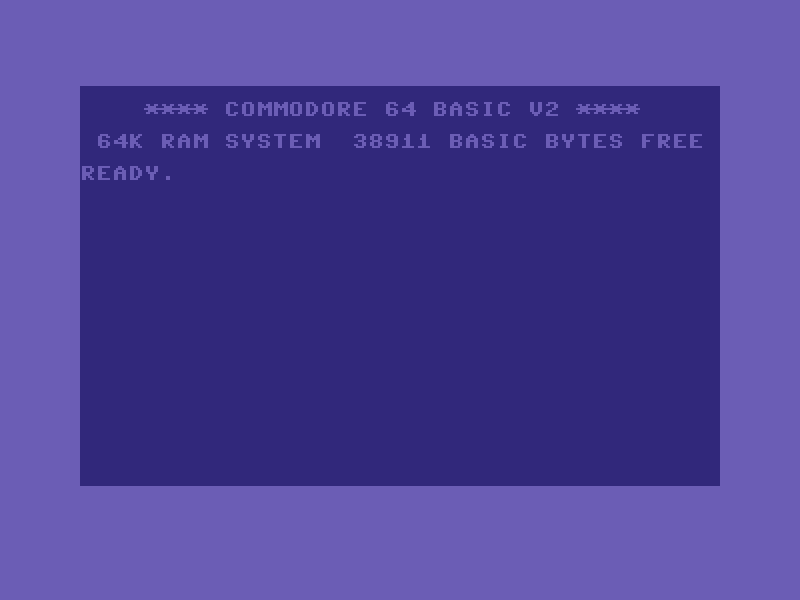
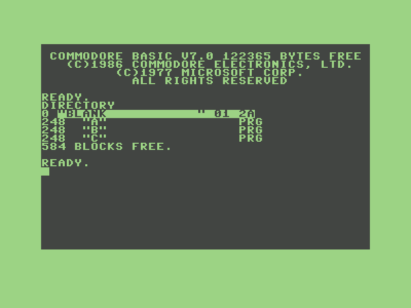
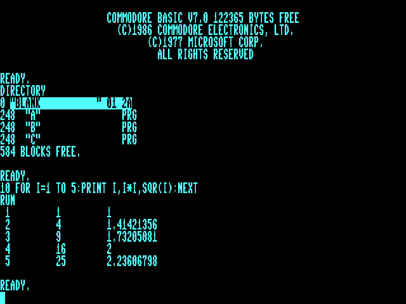
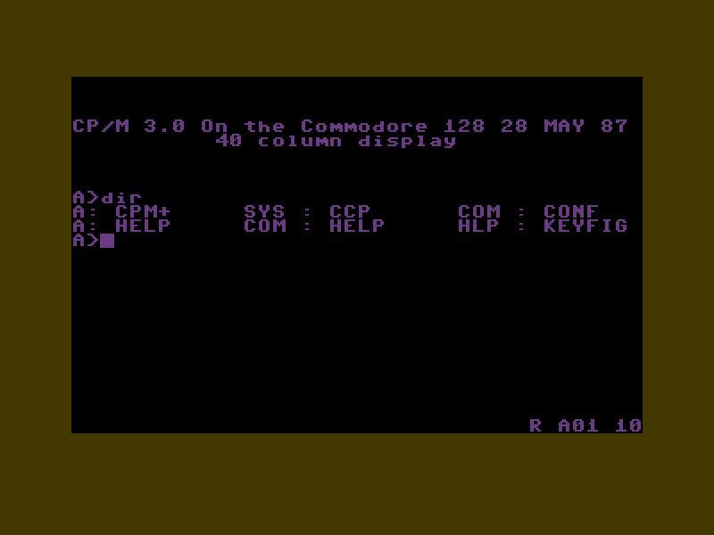
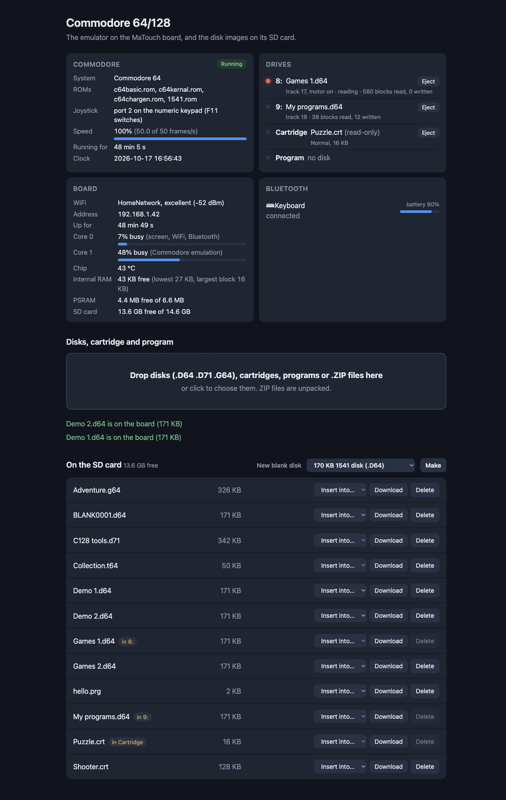
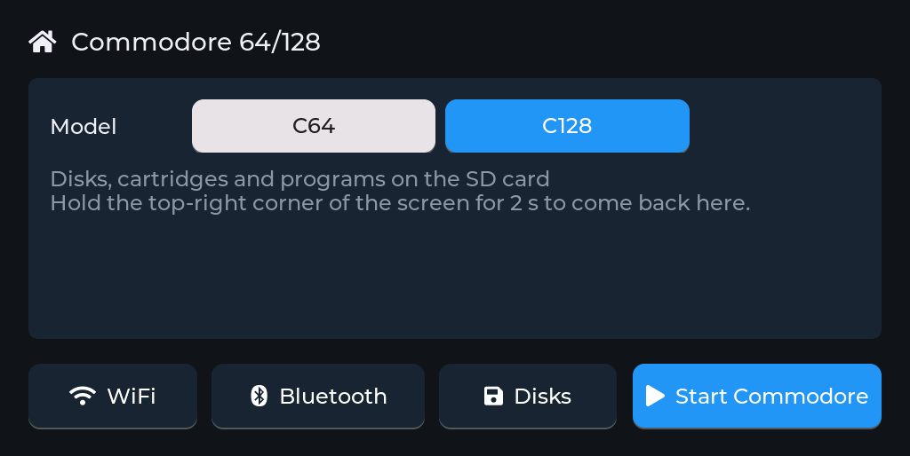
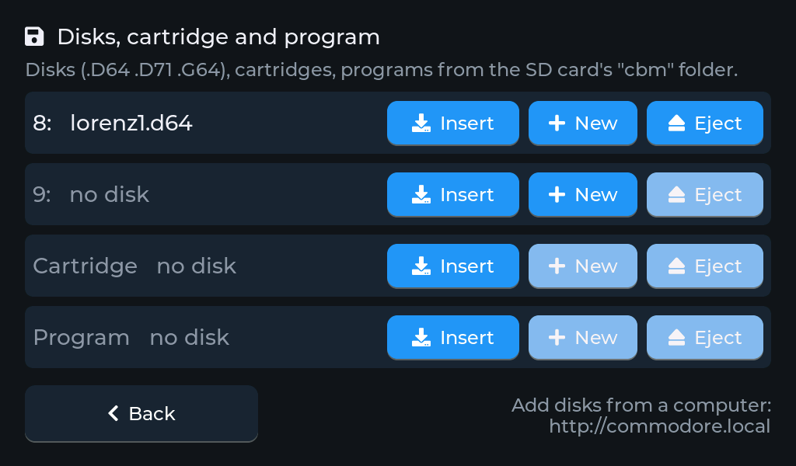
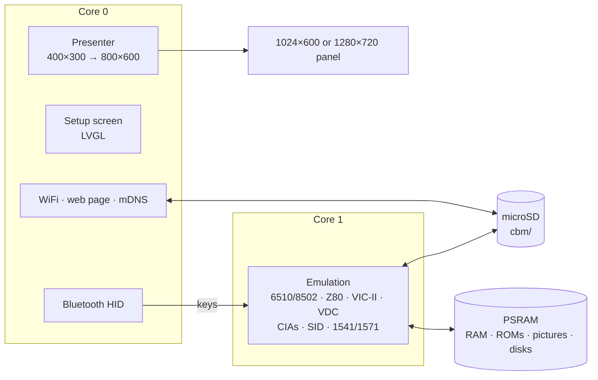

<h1 align="center">esp32cbm</h1>

<p align="center">
  <b>A Commodore 64 or 128 on a 7-inch ESP32-S3 touch-screen board or an M5Stack Tab5.</b><br>
  Cycle-exact 6510 and CIAs, VIC-II, SID, real 1541 and 1571 drives, the C128's 80 columns, FAST mode and CP/M, Bluetooth keyboard.
</p>

<p align="center">
  
  
  
  
  
  
</p>

<p align="center">
  
  
  <br>
  
  
  <br>
  <sub>The C64 at start-up; the C128 listing a double-sided disk in its 1571, in 40 columns and on
  the VDC's 80 columns; CP/M 3.0 on the C128's Z80. Screenshots from the board, border included.</sub>
</p>

esp32cbm turns the Makerfabs MaTouch ESP32-S3 Parallel TFT with Touch 7", or an
M5Stack Tab5, into a Commodore 64 or a Commodore 128. The picture, border included, fills
the panel's height; a Bluetooth keyboard works the Commodore, and disks,
cartridges and programs come from the microSD card. A setup screen on the
touch panel, and a web page on your network, handle everything else.

It's the sibling of [esp32ste](https://github.com/rlucencic/esp32ste) (Atari
STE), [esp32mac](https://github.com/rlucencic/esp32mac) (Macintosh Plus,
SE, Classic), [esp32cpc](https://github.com/rlucencic/esp32cpc) (Amstrad
CPC), [esp32zx](https://github.com/rlucencic/esp32zx) (ZX Spectrum),
[esp32xl](https://github.com/rlucencic/esp32xl) (Atari 800XL and 130XE),
[esp32msx](https://github.com/rlucencic/esp32msx) (MSX1 and MSX2) and
[esp32gs](https://github.com/rlucencic/esp32gs) (Apple IIGS); all eight are
built on the shared runtime
[esp32emu](https://github.com/rlucencic/esp32emu), which also holds the 6502
core (the C64's, the C128's and their drives', shared with the Atari) and
the Z80 core (the C128's, shared with the CPC, the Spectrum and the MSX).

## Features

**The machines**
- **Commodore 64** and **Commodore 128** (PAL), chosen on the setup screen;
  the C128 with 128 KB, BASIC 7.0, and its C64 mode (`GO64`)
- **6510 and 8502**: every bus cycle as the real CPU does it (dummy reads,
  read-modify-write's double write), all undocumented opcodes; passes Klaus
  Dormann's functional test and the whole Lorenz test suite 2.15 (CPU, CIAs,
  interrupts and NMIs to the cycle)
- **VIC-II** (6569): bad lines and sprite DMA take the CPU's cycles, raster
  interrupts, all text and bitmap modes, sprites with collisions, the
  border; lines are drawn as the beam passes them
- **Two 6526 CIAs**: timers to the cycle (start and stop delays, force
  loads, one-shot, timer B counting A, PB6/PB7 outputs), time of day,
  shift register, keyboard, joysticks, the serial bus
- **SID**: three voices (triangle, sawtooth, pulse, noise, ring modulation,
  sync), envelopes, the filter, the `$D418` volume trick for samples
- **C128**: the MMU (banks, common RAM, page 0 and 1 relocation), the
  **VDC's 80 columns** (attributes, cursor, block copy and fill, bitmap
  mode), **FAST** (2 MHz), the **Z80** for the start-up and **CP/M 3.0**,
  the extra keys, CAPS LOCK and 40/80 DISPLAY
- **Cartridges** (`.CRT`): normal 8 and 16 KB, Ultimax, Ocean, Fun Play,
  Super Games, System 3, Dinamic, Magic Desk, Simons' BASIC, EasyFlash
  (read-only)
- **Programs** (`.PRG`, `.T64`) straight into memory, and RUN

**Floppy drives**
- **Drives 8 and 9 emulated whole**: each runs its DOS ROM on its own 6502
  with its VIAs, and the disk turns under the head as GCR: a **1541-II** on
  the C64, a **1571** on the C128 (both sides, 1 and 2 MHz, fast serial with
  the C128, its WD1770 answering)
- **`.D64`** (35 or 40 tracks, with error bytes), **`.D71`** (double-sided,
  C128), **`.G64`** (GCR as it is on the disk)
- Writes go back into the image file: D64 and D71 sectors are decoded from
  the GCR the drive wrote
- **New blank disks**, formatted: a 170 KB D64 on the C64, a 340 KB D71 on
  the C128

**Around it**
- **Setup screen** before the Commodore starts, and any time while it runs
  (hold the top-right corner for 2 seconds): WiFi, Bluetooth pairing, the
  model, drives, reset
- **Bluetooth keyboard** (BLE HID), mapped by position as on a C64, with
  the C128's own keys on free PC keys; joystick on the numeric keypad
- **Web page** at `http://commodore.local`: drop disks, cartridges, programs
  or `.ZIP` files onto it (with a progress bar), put them into drives, eject,
  make blank disks, and watch the machine, drives, board and Bluetooth devices
  live
- **Sound** on the board's speaker (optional, `menuconfig`)

<p align="center">
  
</p>

## Hardware

| | Makerfabs MaTouch ESP32-S3 7" | M5Stack Tab5 |
|---|---|---|
| Chip | ESP32-S3-WROOM-1-N16R8: 16 MB flash, 8 MB octal PSRAM | ESP32-P4 (RISC-V, 360 MHz): 16 MB flash, 32 MB PSRAM; an ESP32-C6 for WiFi and Bluetooth |
| Screen | 7" 1024×600 RGB, GT911 capacitive touch | 5" 1280×720 MIPI-DSI, capacitive touch, held landscape |
| Storage | microSD card (FAT32 or exFAT) | microSD card (FAT32 or exFAT) |
| Input | any BLE keyboard | any BLE keyboard, or the Tab5 Keyboard |
| Sound | a speaker on the MAX98357A output (optional, `menuconfig`) | the built-in speaker (ES8388) |

The VIC-II's picture is 400×300: the 320×200 screen with 40 pixels of
border left and right and 50 lines above and below. Every pixel is shown
twice in each direction, so it fills the panel's height as 800×600 (on the
Tab5 2.4 times: 960×720). The C128's 80 columns (640×200) are drawn 800
pixels wide, each character cell ten pixels, and every line three times (on
the Tab5 960 wide, every line 3.6 times).

## Getting started

### 1. What you need

- [ESP-IDF](https://github.com/espressif/esp-idf) v5.5 (developed with v5.5.4)
- [esp32emu](https://github.com/rlucencic/esp32emu), checked out next to this project (`../esp32emu`)
- The Commodore ROM images in `roms/` (see [roms/README.md](roms/README.md))
- A microSD card, FAT32 or exFAT

### 2. Build and flash

```sh
git clone https://github.com/rlucencic/esp32emu.git     # the shared runtime, next to it
git clone https://github.com/rlucencic/esp32cbm.git && cd esp32cbm
idf.py build
idf.py -p /dev/cu.usbmodem… flash      # app and the ROM images

# or for the M5Stack Tab5 (its own build folder and settings):
idf.py -B build-tab5 -DIDF_TARGET=esp32p4 -DSDKCONFIG=build-tab5/sdkconfig build
idf.py -B build-tab5 -DIDF_TARGET=esp32p4 -DSDKCONFIG=build-tab5/sdkconfig -p /dev/cu.usbmodem… flash
```

Later updates only need `idf.py -p … app-flash`. Instead of flashing the
ROMs, you can also copy them into a `roms` folder on the SD card.

### 3. First start

1. The board starts on the **setup screen**. Tap **WiFi** to join your
   network: the clock is set from the internet, and the web page becomes
   reachable.
2. Tap **Bluetooth** to pair a keyboard.
3. Choose the **model**, then tap **Start**.
4. Open `http://commodore.local`, drop a disk image onto the page, then
   **Insert into… → 8:**, and on the Commodore `LOAD "$",8` and `LIST`.

<p align="center">
  
</p>

## Using it

| To | Do |
|---|---|
| Get back to the setup screen | Hold the top-right corner of the screen for 2 s |
| Change the model | On the setup screen; **Restart** applies it |
| Load from a disk | Insert it into **8:**, then `LOAD "$",8` and `LIST` for the directory, `LOAD "NAME",8,1` and `RUN`; on the C128 `DIRECTORY` and `RUN "NAME"` |
| Make a new disk | **New** next to 8: or 9: on the drives page, or on the web page |
| Run a program file | Insert the `.PRG`/`.T64` into **Program**: it's loaded and RUN (and again at every start) |
| Use a cartridge | Insert the `.CRT` into **Cartridge**: the machine starts again with it |
| The C128's 80 columns | **40/80 DISPLAY** (Print Screen) shows the 80-column screen while it's down; down at a reset, the C128 starts there |
| CP/M | Insert the C128 CP/M system disk into 8: and reset the C128 |
| Copy files from a computer | Drop them onto the web page (ZIP files are unpacked), or `curl -T game.d64 http://commodore.local/disks/` |

Disks, cartridges and programs live in the `cbm` folder on the SD card. The
inserted ones are remembered across restarts.

<p align="center">
  
</p>

**Keyboard**, by position as VICE maps a PC keyboard: the C64's keys where
a PC has them (`` ` `` is ←, `-` is +, `=` is −, `[` is @, `]` is \*, `;` is :,
`'` is ;, the ISO `#` key is =, `\` is £). Esc is RUN/STOP, Tab is CTRL,
Ctrl and Alt are C=, Home is CLR/HOME, Page Up is RESTORE, Page Down is ↑,
Insert is INST, Backspace and Delete are DEL; the cursor keys as on the C64
(left and up with SHIFT), F1–F8 (F2, F4, F6, F8 with SHIFT). On the C128:
F9 is ESC, F10 HELP, AltGr ALT, End LINE FEED, Scroll Lock NO SCROLL, Caps
Lock CAPS LOCK and Print Screen 40/80 DISPLAY (the last two lock, as on the
C128).

**Joystick**: the numeric keypad (8 4 6 2 and the diagonals, 5 or 0 fire)
in port 2; F11 switches it to port 1. F12 makes the cursor keys the
joystick as well, with Alt as fire.

## Configuration

`idf.py menuconfig` → **Emulator board**:

| Option | Default | |
|---|---|---|
| WiFi, setup screen | on | Time zone for the clock (POSIX TZ) |
| Start by itself | off | Countdown on the setup screen |
| Web page, network name | on, `commodore` | `http://<name>.local` |
| BLE keyboard and mouse | on | |
| Sound on the speaker | off | Volume; moves the console to the UART port |

## How it works



- **`components/cbm`**: the C64 and C128, platform independent. It also
  builds on a desktop (`components/cbm/host`) for testing with scripted
  typing, keys and joystick, disks, cartridges and programs, screenshots,
  sound recording and CPU traces.
- **`main`**: the Commodore on the board: memory, ROMs, settings, keyboard
  map, drives and status.
- **[esp32emu](https://github.com/rlucencic/esp32emu)**: the board runtime,
  the 6502 core and the Z80 core.

A frame is 312 raster lines of 63 cycles (PAL, 985,248 Hz). The CPU runs a
line at a time up to the next CIA event that matters (an interrupt or a
shift register byte); the VIC draws each line at its end and keeps lines
that didn't change. The drives run behind the computer and catch up at
every line and whenever it reads the serial bus; the computer's bus changes
are kept with their cycle times, so each drive sees them at the right
moment. A drive in the DOS's idle loop isn't run at all until the computer
moves the bus.

## Development

```sh
make -C components/cbm/host                                      # desktop build of the core
CBM_DISK8=game.d64 components/cbm/host/build/cbm_host c64 3000 out.ppm
make -C ../esp32emu/components/m6502/test                        # the 6502 tests
../esp32emu/components/m6502/test/build/functional 6502_functional_test.bin

python ../esp32emu/tools/emu_console.py /dev/cu.usbmodem… lcd screen.png         # screenshot of the panel
python ../esp32emu/tools/emu_console.py /dev/cu.usbmodem… send 'T print 1'       # type on the Commodore
python ../esp32emu/tools/emu_console.py /dev/cu.usbmodem… profile build/esp32cbm.elf  # where the time goes
curl http://commodore.local/api/status                                           # live status as JSON
```

`CLAUDE.md` has the details: architecture, timing, the drives, debugging
options and the lessons learned along the way.

## Limitations

- The M5Stack Tab5 port is new: the machine starts there and runs at full
  speed at its start-up screen, with core 1 far less busy than on the S3,
  but sound, touch, Bluetooth and the Tab5 Keyboard have not been tried on
  it by hand yet.
- PAL only; the SID is a 6581 with a simple filter model.
- Tested so far with the Lorenz suite, BASIC, the KERNAL's disk commands,
  the C128's burst loading and CP/M; **fast loaders, games and demos,
  cartridges, `.G64` and `.T64` haven't been tried yet**.
- A busy drive costs time: a 1541 loading runs the C64 at 96–100% speed, a
  1571 at 2 MHz (CP/M starting) the C128 at 70–90%.
- The 1571's WD1770 isn't emulated (MFM disks for CP/M from other machines
  don't read); the VDC has no interlace or light pen, and FAST doesn't slow
  I/O accesses or disturb the 40-column picture as on a real C128.
- No datasette, REU, printer or 1351 mouse; no C128 function ROMs.

## Credits

- [VICE](https://vice-emu.sourceforge.io/): the reference for the C128's MMU
  and Z80 memory map, the 1571 and how the CIAs behave
- Wolfgang Lorenz's C64 Emulator Test Suite (public domain, from VICE's
  test programs) and Klaus Dormann's 6502 functional tests
- [zimmers.net](https://www.zimmers.net/): the ROM images and the C128 CP/M
  system disk
- [LVGL](https://lvgl.io) for the setup screen
- [ESP-IDF](https://github.com/espressif/esp-idf) and NimBLE

## Licence

[MIT](LICENSE). LVGL (MIT) and ESP-IDF (Apache 2.0) are fetched at build time
and keep their own licences.

Commodore, C64 and C128 are trademarks of their owners. The ROM images are
not part of this repository.
